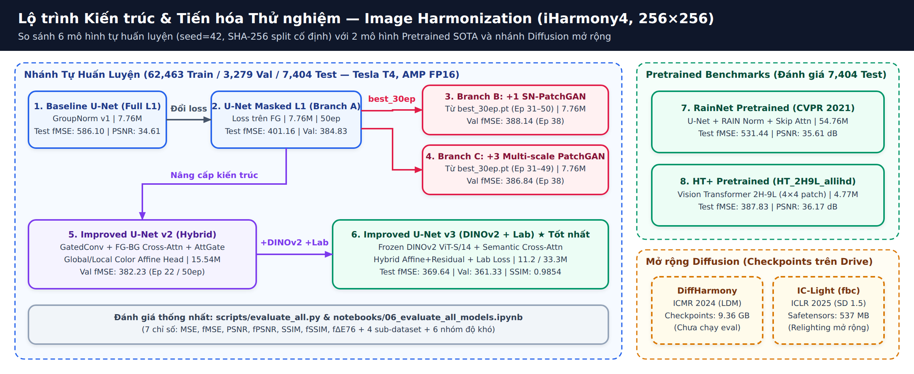
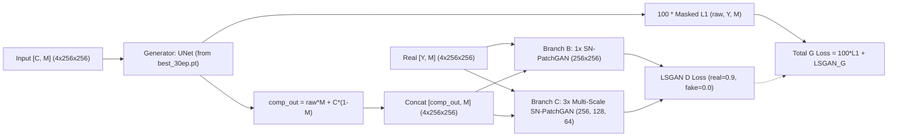
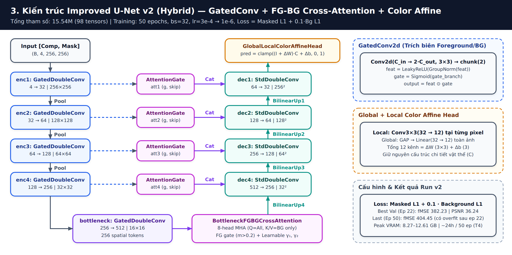
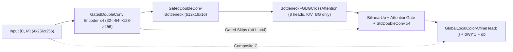
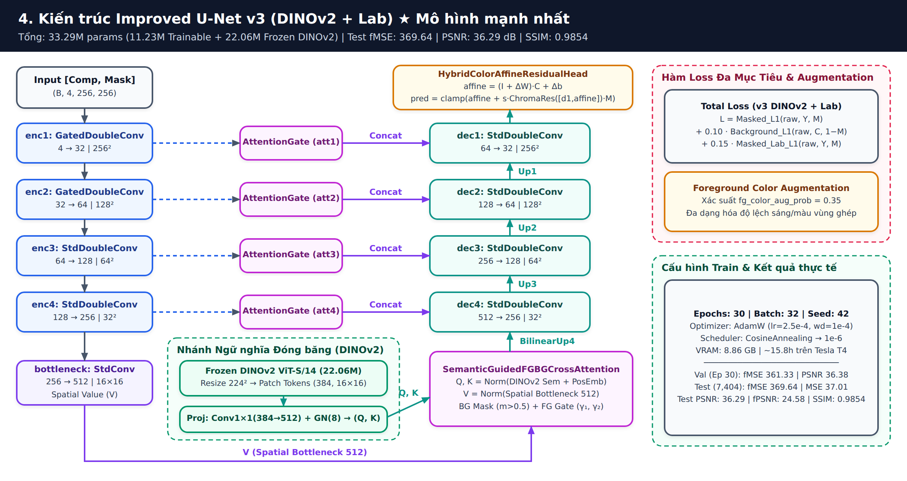
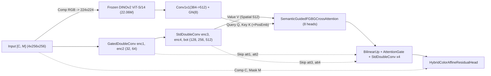
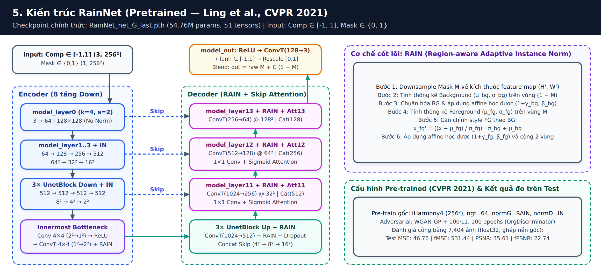
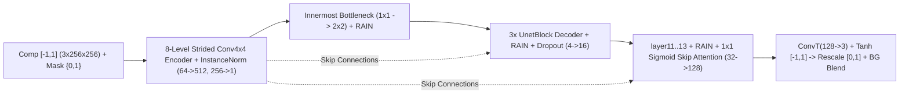
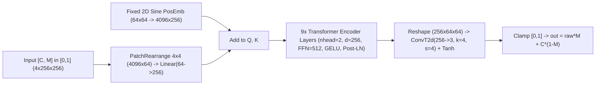

# Kiến trúc Mô hình & Cấu hình Huấn luyện / Pre-trained — Image Harmonization

Tài liệu này tổng hợp đầy đủ **hình vẽ kiến trúc**, **luồng dữ liệu / kích thước tensor**, và **cấu hình huấn luyện (train) hoặc pre-trained** của toàn bộ các mô hình đã sử dụng trong dự án **ImageHarmonization** trên bộ dữ liệu **iHarmony4 (256×256)**.

---

## 0. Thiết lập Dữ liệu & Quy ước Thử nghiệm Chung

Toàn bộ các mô hình tự huấn luyện và pre-trained đều được đánh giá trên cùng một tập dữ liệu chuẩn hóa để đảm bảo so sánh công bằng:

| Thành phần | Giá trị chuẩn hóa |
|---|---|
| **Bộ dữ liệu** | **iHarmony4** (73.146 ảnh từ 4 tập con: `HCOCO`, `HAdobe5k`, `HFlickr`, `Hday2night`) |
| **Kích thước ảnh** | `256 × 256` (RGB dùng `BICUBIC`, mask nhị phân dùng `NEAREST` giữ nguyên `0/255`) |
| **Chia tập dữ liệu** | **62.463 Train / 3.279 Val / 7.404 Test** (`val_fraction = 0.05`, chia nhóm theo `sourceID` nền gốc để đảm bảo 0% rò rỉ dữ liệu) |
| **Mã xác minh split (SHA-256)** | `aad71bde27817a76a2ab959e795b0798dff7fe526c5fe16ec6663e43e79de6be` (khớp 100% ở tất cả 6 run tự train) |
| **Seed tái lập** | `seed = 42`, `cudnn.deterministic = True`, `cudnn.benchmark = False` |
| **Phân tầng độ khó Test** | 6 nhóm (`small`/`large` theo `mask_ratio` median = `4.72%` × `low`/`medium`/`high` theo CIE Lab D65 $\Delta E_{76}$ với $q_1 = 11.87$, $q_2 = 18.15$) |
| **Hậu xử lý ghép nền gốc** | $I_{\text{out}} = \text{clip}(\hat{I}_{\text{raw}} \odot M + I_{\text{comp}} \odot (1 - M),\ 0,\ 1)$ |
| **Môi trường train thực tế** | Google Colab — GPU **NVIDIA Tesla T4 (15 GB VRAM)**, PyTorch `2.14.1+cu130`, Python `3.13.16` |

---

## Phần I — Các Kiến trúc Tự Huấn Luyện (Trained on iHarmony4)

### 1. Baseline U-Net (`unet_groupnorm_v1`) — Full L1 & Masked L1 (Branch A)

- **Mã nguồn:** `src/iharmony/models/unet.py` (`Block`, `UNet`) | `scripts/train_unet.py`
- **Thư mục run:** `runs/unet_full_l1_all4_bs32_seed42/` và `runs/unet_masked_l1_50ep_all4_bs32_seed42/`
- **Quy mô:** **7.76M tham số** (64 tensors)

#### Luồng kiến trúc (Mermaid)

```mermaid
flowchart LR
    IN["Input [Comp, Mask] (4x256x256)"] --> E0["enc.0 Block (32x256x256)"]
    E0 -->|"MaxPool2d(2)"| E1["enc.1 Block (64x128x128)"]
    E1 -->|"MaxPool2d(2)"| E2["enc.2 Block (128x64x64)"]
    E2 -->|"MaxPool2d(2)"| E3["enc.3 Block (256x32x32)"]
    E3 -->|"MaxPool2d(2)"| E4["Bottleneck enc.4 (512x16x16)"]
    E4 -->|"ConvTranspose2d(2)"| D0["dec.0 Block (256x32x32)"]
    E3 -.->|"Skip Concat"| D0
    D0 -->|"ConvTranspose2d(2)"| D1["dec.1 Block (128x64x64)"]
    E2 -.->|"Skip Concat"| D1
    D1 -->|"ConvTranspose2d(2)"| D2["dec.2 Block (64x128x128)"]
    E1 -.->|"Skip Concat"| D2
    D2 -->|"ConvTranspose2d(2)"| D3["dec.3 Block (32x256x256)"]
    E0 -.->|"Skip Concat"| D3
    D3 --> HEAD["Conv1x1(32->3) + Sigmoid"]
    HEAD --> BLEND["out = raw*M + C*(1-M)"]
```

#### Đặc điểm kỹ thuật
- Mỗi `Block` gồm 2 lớp `Conv2d(3×3, padding=1, bias=False) → GroupNorm(8) → ReLU`. Dùng `GroupNorm(8)` thay cho `BatchNorm` giúp ổn định khi batch size thay đổi và không phụ thuộc thống kê giữa các ảnh khác nhau.
- **Khác biệt duy nhất giữa Run 1 và Run 2 là hàm Loss:**
  - **Run 1 (Full L1):**
    $$\mathcal{L}_{\text{full}} = \frac{1}{3HW} \sum_{c,h,w} |\hat{I}_{\text{raw}} - I_{\text{real}}|$$
  - **Run 2 (Masked L1 — Branch A):** chuẩn hóa theo diện tích vùng foreground $M$ của từng ảnh để vùng vật thể nhỏ không bị lu mờ bởi nền lớn:
    $$\mathcal{L}_{\text{masked}} = \frac{1}{B} \sum_{b=1}^{B} \frac{\sum_{c,h,w} |\hat{I}_{\text{raw}}^{(b)} - I_{\text{real}}^{(b)}| \cdot M^{(b)}}{3 \cdot \max(\sum_{h,w} M^{(b)},\ \epsilon)}$$

#### Cấu hình huấn luyện
| Tham số | Run 1: U-Net Full L1 | Run 2: U-Net Masked L1 (Branch A) |
|---|---|---|
| **Kiến trúc** | `unet_groupnorm_v1` (`base_channels=32`) | `unet_groupnorm_v1` (`base_channels=32`) |
| **Hàm Loss** | `raw_full_image_l1` | `masked_l1` ($\epsilon = 10^{-6}$) |
| **Epochs** | 50 (Best tại Epoch **39**) | 50 (Best tại Epoch **39**; lưu mốc `best_30ep.pt` cho GAN) |
| **Batch Size / Workers** | `32` / `2` | `32` / `2` |
| **Optimizer** | `Adam(lr=3e-4, betas=(0.9, 0.999))` | `Adam(lr=3e-4, betas=(0.9, 0.999))` |
| **LR Scheduler** | `CosineAnnealingLR(T_max=50, eta_min=1e-6)` | `CosineAnnealingLR(T_max=50, eta_min=1e-6)` |
| **Augmentation** | Random Horizontal Flip ($p = 0.5$) | Random Horizontal Flip ($p = 0.5$) |
| **Precision / Grad Clip** | AMP FP16 (`GradScaler`) / `clip_grad_norm = 1.0` | AMP FP16 (`GradScaler`) / `clip_grad_norm = 1.0` |
| **Tài nguyên thực tế (T4)** | ~878s/epoch (~11.95h) · Peak VRAM `6.01–11.64 GB` | ~880s/epoch (~12.22h) · Peak VRAM `6.01 GB` |
| **Kết quả Best Val (3.279)** | MSE `59.28` · fMSE `556.07` · PSNR `34.77` | MSE `39.64` · fMSE `384.83` · PSNR `36.11` |
| **Kết quả Test (7.404, Blind)** | MSE `60.59` · fMSE `586.10` · PSNR `34.61` · fPSNR `22.55` · SSIM `0.9815` · fSSIM `0.8786` · fΔE76 `11.69` (`4.68 ms/ảnh`) | MSE `41.67` · fMSE `401.16` · PSNR `35.95` · fPSNR `24.16` · SSIM `0.9845` · fSSIM `0.9055` · fΔE76 `10.05` (`4.79 ms/ảnh`) |

---

### 2. U-Net + Spectral-Norm PatchGAN — Branch B (1-Scale) & Branch C (3-Scale Multi-Scale)

- **Mã nguồn:** `src/iharmony/models/unet.py` + `src/iharmony/models/discriminators.py` | `scripts/train_patchgan.py`
- **Thư mục run:** `runs/unet_branchB_1patchgan_50ep_all4_bs32_seed42/` và `runs/unet_branchC_3patchgan_50ep_all4_bs32_seed42/`
- **Quy mô:** Generator `UNet` (**7.76M**) + Discriminator `SN-PatchGAN` (1 scale ở Branch B / 3 scales ở Branch C)

#### Luồng kiến trúc (Mermaid)

#### Kiến trúc Discriminator & Cơ chế ổn định GAN
- **70×70 Spectral-Norm PatchGAN (`ndf=64`, input 4 kênh `[RGB, Mask]`):**
  1. `SN-Conv2d(4 → 64, k=4, s=2, p=1) → LeakyReLU(0.2)`
  2. `SN-Conv2d(64 → 128, k=4, s=2, p=1) → InstanceNorm2d → LeakyReLU(0.2)`
  3. `SN-Conv2d(128 → 256, k=4, s=2, p=1) → InstanceNorm2d → LeakyReLU(0.2)`
  4. `SN-Conv2d(256 → 512, k=4, s=1, p=1) → InstanceNorm2d → LeakyReLU(0.2)`
  5. `SN-Conv2d(512 → 1, k=4, s=1, p=1)` (bản đồ phán đoán patch-level).
- **Branch C (Multi-scale `num_D = 3`):** Dùng 3 bộ PatchGAN độc lập trên độ phân giải gốc `256²`, downsample `128²` và `64²` qua `AvgPool2d(3, stride=2, padding=1)`, lấy trung bình loss trên 3 scale.
- **Ổn định huấn luyện:** Khởi tạo Generator từ mốc `best_30ep.pt` (Val fMSE `397.88`), **đóng băng G tại Epoch 31** (D-Warmup), áp dụng `n_critic = 2` ở 3 epoch đầu (Ep 31–33), label smoothing `real_label = 0.9` với LSGAN:
  $$\mathcal{L}_D = \frac{1}{2K}\sum_{k=1}^{K}\Big[\text{MSE}(D_k(Y, M), 0.9) + \text{MSE}(D_k(I_{\text{out}}, M), 0)\Big], \qquad \mathcal{L}_G = 100\,\mathcal{L}_{\text{masked}} + \frac{1}{K}\sum_{k=1}^{K}\text{MSE}(D_k(I_{\text{out}}, M), 1)$$

#### Cấu hình huấn luyện
| Tham số | Run 3: Branch B (1-PatchGAN) | Run 4: Branch C (3-Multi-Scale PatchGAN) |
|---|---|---|
| **Checkpoint khởi tạo** | `unet_masked_l1/best_30ep.pt` (Ep 29, Val fMSE `397.88`) | `unet_masked_l1/best_30ep.pt` |
| **Giai đoạn fine-tune** | Epoch `31 → 50` (20 epochs) | Epoch `31 → 49` (19/20 epochs) |
| **Discriminator** | `1× SN-PatchGAN` (`ndf=64`) | `3× Multi-Scale SN-PatchGAN` (`num_D=3, ndf=64`) |
| **Optimizer G / D** | `Adam(lr_G=5e-5, betas=(0.5, 0.999))` / `Adam(lr_D=1e-4)` | `Adam(lr_G=5e-5, betas=(0.5, 0.999))` / `Adam(lr_D=1e-4)` |
| **Scheduler G / D** | `CosineAnnealingLR` (`T_max=19` / `20`, `eta_min=1e-6`) | `CosineAnnealingLR` (`T_max=19` / `20`, `eta_min=1e-6`) |
| **Cân bằng GAN** | `lambda_l1=100`, `real_label=0.9`, D-Warmup Ep 31, `n_critic=2` (Ep 31–33) | Giống Branch B |
| **Tài nguyên thực tế (T4)** | ~1.618s/epoch (~8.99h) · Peak VRAM `6.13 GB` | ~1.795s/epoch (~9.48h) · Peak VRAM `6.24 GB` |
| **Kết quả Best Val (3.279)** | Ep **38**: MSE `40.20` · fMSE `388.14` · PSNR `36.08` | Ep **38**: MSE `40.05` · fMSE `386.84` · PSNR `36.10` |
| **Kết quả Test (7.404, Blind)** | MSE `41.98` · fMSE `401.50` · PSNR `35.92` · fPSNR `24.12` · SSIM `0.9843` · fSSIM `0.9041` · fΔE76 `10.20` (`4.81 ms/ảnh`) | MSE `41.87` · fMSE `400.34` · PSNR `35.93` · fPSNR `24.14` · SSIM `0.9843` · fSSIM `0.9045` · fΔE76 `10.15` (`4.78 ms/ảnh`) |

---

### 3. Improved U-Net v2 (Hybrid)

- **Mã nguồn:** `src/iharmony/models/improved_unet_v2.py` + `src/iharmony/models/blocks.py` | `scripts/train_improved_unet.py --version v2`
- **Thư mục run:** `runs/improved_unet_v2_hybrid_probe10ep_bs32_seed42/`
- **Quy mô:** **15.54M tham số** (98 tensors)

#### Luồng kiến trúc (Mermaid)

#### 4 Cải tiến cốt lõi so với Baseline U-Net
1. **Gated Convolution (`GatedDoubleConv`) ở toàn bộ Encoder & Bottleneck:** Nhân đôi kênh đầu ra rồi tách thành nhánh đặc trưng và nhánh cổng $\text{LeakyReLU}(\text{GN}(\text{feat})) \odot \sigma(\text{gate})$, giúp học tách bạch ranh giới foreground/background ngay từ các tầng thấp.
2. **Bottleneck FG-BG Cross-Attention (8 heads ở độ phân giải `16×16`):** Dùng `key_padding_mask = (m_low > 0.5)` để ép các token foreground truy vấn thông tin ánh sáng **chỉ từ vùng background**, sau đó cập nhật chọn lọc vùng foreground (`m_low > 0.2`) với hệ số residual học được $\gamma_1, \gamma_2$ khởi tạo bằng 0.
3. **Bilinear Upsampling + Attention Gate:** Thay `ConvTranspose2d` bằng `Upsample(bilinear) + Conv3×3` để loại bỏ nhiễu ô bàn cờ (checkerboard artifacts), kết hợp `AttentionGate` lọc nhiễu trên cả 4 đường skip connection.
4. **Global + Local Color Affine Head:** Thay vì dự đoán trực tiếp pixel RGB (dễ làm mờ kết cấu vật thể), đầu ra dự đoán trường biến đổi màu affine 12 kênh (ma trận $3\times 3$ $\Delta W$ + độ lệch $\Delta b$, cộng nhánh Local 3×3 và Global GAP-FC):
   $$\hat{I}_{\text{raw}} = \text{clip}\big((I + \Delta W) \cdot I_{\text{comp}} + \Delta b,\ 0,\ 1\big)$$

#### Cấu hình huấn luyện
| Tham số | Giá trị thực tế (`v2_best.pt`) |
|---|---|
| **Kiến trúc** | `ImprovedHarmonizationUNet_v2` (`base_channels=32`, `num_heads=8`) |
| **Hàm Loss** | $\mathcal{L} = \mathcal{L}_{\text{masked\_L1}} + 0.1 \cdot \mathcal{L}_{\text{bg\_L1}}$ (`bg_weight = 0.1`) |
| **Epochs** | 50 (Best Val fMSE tại Epoch **22**, Best Val MSE tại Epoch **29**; có dấu hiệu overfit nhẹ dần tới Ep 50 `404.45`) |
| **Batch Size / LR** | `32` · `lr = 3e-4 → min_lr = 1e-6` (CosineAnnealing) |
| **Tài nguyên thực tế (T4)** | ~1.728s/epoch (~24.00h / 50 ep) · Peak VRAM `8.27–12.61 GB` |
| **Kết quả Best Val (3.279)** | Ep **22**: MSE `39.71` · fMSE `382.23` · PSNR `36.24` · fPSNR `24.67` |
| **Kết quả Test (7.404, Blind)** | MSE `40.37` · fMSE `386.48` · PSNR `36.15` · fPSNR `24.44` · SSIM `0.9850` · fSSIM `0.9093` · fΔE76 `9.91` (`8.41 ms/ảnh`) |

---

### 4. Improved U-Net v3 (`dinov2_lab`) — Mô hình Mạnh Nhất Hiện Tại

- **Mã nguồn:** `src/iharmony/models/improved_unet_v3.py` | `scripts/train_improved_unet.py --version v3`
- **Thư mục run:** `runs/improved_unet_v3_dinov2_lab_30ep_bs32_seed42/`
- **Quy mô:** **33.29M tổng tham số** (**11.23M Trainable** + **22.06M Frozen DINOv2 ViT-S/14**, 287 tensors)

#### Luồng kiến trúc (Mermaid)

#### 4 Đột phá kỹ thuật vượt trội so với v2
1. **Nhánh ngữ nghĩa đóng băng `FrozenDINOv2Guide` (`dinov2_vits14`):** Trích xuất đặc trưng ngữ nghĩa giàu thông tin vật liệu/bối cảnh trên ảnh `224×224` (đóng băng hoàn toàn trọng số, luôn giữ ở `.eval()`), chiếu về `512 × 16 × 16` qua `Conv1×1 + GroupNorm`.
2. **Semantic-Guided FG-BG Cross-Attention:** Dùng đặc trưng ngữ nghĩa DINOv2 + `pos_emb` làm **Query & Key** (tìm các vùng nền có cùng ngữ nghĩa/vật liệu chiếu sáng), trong khi lấy **Value** từ đặc trưng không gian/màu sắc ở Bottleneck CNN — giải quyết tận gốc nhược điểm overfit và khớp sai nền của v2!
3. **Hybrid Encoder + Hybrid Color Affine Residual Head:** Chỉ giữ `GatedDoubleConv` ở 2 tầng nông (`enc1, enc2`) để giảm tham số thừa (từ 15.54M xuống 11.23M trainable), đồng thời bổ sung nhánh **Chroma Residual** (`Conv3×3 → GN → LReLU → Conv3×3 → Tanh` nhân hệ số `res_scale` học được trên vùng foreground) lên trên ảnh Affine để tinh chỉnh các hiệu ứng phi tuyến (bóng đổ, chuyển sắc mềm).
4. **Hàm Loss cảm nhận màu CIE Lab + Foreground Color Augmentation:**
   $$\mathcal{L}_{\text{v3}} = \mathcal{L}_{\text{masked\_L1}} + 0.10\,\mathcal{L}_{\text{bg\_L1}} + 0.15\,\mathcal{L}_{\text{masked\_Lab\_L1}}$$
   kết hợp tăng cường màu sắc ngẫu nhiên trên vùng foreground (`fg_color_aug_prob = 0.35`) giúp tổng quát hóa cực tốt trên tập Test.

#### Cấu hình huấn luyện
| Tham số | Giá trị thực tế (`config.json`) |
|---|---|
| **Kiến trúc** | `improved_unet_v3_dinov2_lab` (`base_channels=32`, `num_heads=8`) |
| **Tham số** | `11.23M` trainable / `33.29M` total (DINOv2 ViT-S/14 frozen) |
| **Epochs** | `30` (Best tại Epoch **30** — vẫn còn dư địa giảm thêm nếu train tiếp!) |
| **Optimizer / Weight Decay** | `AdamW(lr=2.5e-4, weight_decay=1e-4)` |
| **Scheduler** | `CosineAnnealingLR(T_max=30, eta_min=1e-6)` |
| **Trọng số Loss** | `lambda_bg = 0.10`, `lambda_lab = 0.15` |
| **Data Augmentation** | Horizontal Flip ($0.5$) + Foreground Color Augmentation (`fg_color_aug_prob = 0.35`) |
| **Tài nguyên thực tế (T4)** | ~1.899s/epoch (~15.82h / 30 ep) · Peak VRAM `8.86 GB` |
| **Kết quả Best Val (3.279)** | Ep **30**: MSE `36.89` · fMSE `361.33` · PSNR `36.38` · fPSNR `24.82` |
| **Kết quả Test (7.404, Blind)** | **MSE `37.01` · fMSE `369.64` · PSNR `36.29` · fPSNR `24.58` · SSIM `0.9854` · fSSIM `0.9113` · fΔE76 `9.67`** (`10.11 ms/ảnh`) |

---

## Phần II — Các Kiến trúc Pre-trained Benchmarks

### 5. RainNet Pretrained (Ling et al., CVPR 2021)

- **Paper:** *"Region-aware Adaptive Instance Normalization for Image Harmonization"*, CVPR 2021
- **Mã nguồn tích hợp:** `src/iharmony/models/rainnet.py` (`RAIN`, `UnetBlockCodec`, `RainNet`)
- **Checkpoint trên Drive:** `runs/RainNet_Pretrained/RainNet_net_G_last.pth` (**54.76M tham số**, 51 tensors — bản chính thức **256×256**, không phải bản Update 2021.07 512×512)

#### Luồng kiến trúc (Mermaid)

#### Cơ chế RAIN (Region-aware Adaptive Instance Normalization)
Ở cả 7 tầng Decoder, mô-đun `RAIN` tách riêng vùng foreground ($M$) và background ($1 - M$) trên bản đồ đặc trưng, chuẩn hóa foreground rồi chuyển giao trung bình $\mu_{\text{bg}}$ và độ lệch chuẩn $\sigma_{\text{bg}}$ của background sang foreground trước khi qua tham số affine học được $(\gamma_{\text{fg}}, \beta_{\text{fg}}, \gamma_{\text{bg}}, \beta_{\text{bg}})$:
$$x_{\text{fg}}' = \left(\frac{x - \mu_{\text{fg}}}{\sigma_{\text{fg}}}\,\sigma_{\text{bg}} + \mu_{\text{bg}}\right)(1 + \gamma_{\text{fg}}) + \beta_{\text{fg}}$$

#### Cấu hình Pre-train gốc & Thiết lập suy luận
| Hạng mục | Cấu hình |
|---|---|
| **Repo & Checkpoint gốc** | `junleen/RainNet` — bản chính thức 256×256 `net_G_last.pth` (`1NMvHbnD1kW-j1KKMxEb9R9IR5drMK3GQ`) |
| **Cấu hình mạng** | `input_nc=3`, `output_nc=3`, `ngf=64`, `norm_type_indicator=[0]*7 + [1]*7` (IN ở Encoder, RAIN ở Decoder), `use_attention=True`, `use_dropout=True` |
| **Cấu hình pre-train gốc** | Tập iHarmony4 (256×256), `WGAN-GP` + `OrgDiscriminator` + `100·L1`, `Adam(lr=2e-4, beta1=0.5)`, `niter=100` |
| **Tiền/Hậu xử lý đánh giá** | Chuẩn hóa ảnh vào `[-1, 1]`, mask `{0, 1}`, chạy **float32** (tránh sai số fp16 trong phương sai RAIN), quy đổi về `[0, 1]` và ghép nền gốc |
| **Kết quả Test (7.404, Blind công bằng)** | MSE `58.09` · fMSE `619.18` · PSNR `34.27` · fPSNR `22.09` · SSIM `0.9806` · fSSIM `0.8654` · fΔE76 `11.95` (`6.93 ms/ảnh`) |
| **Tham chiếu Official Protocol (`GT-BG*`)** | MSE `46.76` · fMSE `531.44` · PSNR `35.62` · fPSNR `22.74` · SSIM `0.9868*` · fSSIM `0.8742` · fΔE76 `11.07` *(có rò rỉ nền Ground-Truth — xem Phần IV.4)* |

---

### 6. Harmony Transformer — HT+ (`HT_2H9L_allihd`, Pretrained)

- **Paper:** Guo et al., *"Image Harmonization with Transformer"* (ICCV 2021) / *"Transformer for Image Harmonization and Beyond"* (TPAMI 2022)
- **Mã nguồn tích hợp:** `src/iharmony/models/ht_plus.py` (`PatchRearrange`, `HTTransformerEncoder*`, `HTGenerator`)
- **Checkpoint trên Drive:** `runs/ht_plus_pretrained/HT_2H9L_allihd_latest_net_G.pth` (**4.77M tham số**, 112 tensors — bản `FCHT_2H9L_allihd`, khác với bản lớn hơn `DHT+`)

#### Luồng kiến trúc (Mermaid)

#### Cấu hình Pre-train gốc & Thiết lập suy luận
| Hạng mục | Cấu hình |
|---|---|
| **Repo & Checkpoint gốc** | `zhenglab/HarmonyTransformer` — `FCHT_2H9L_allihd/latest_net_G.pth` (`FC-TRE-DeCNN`, không có CNN encoder & không tách Reflectance/Illumination như `DHT+`) |
| **Cấu hình mạng** | `--model ht`, `ksize=stride=4`, `dim=256`, `tr_r_enc_head=2`, `tr_r_enc_layers=9`, `dim_forward=2` (`FFN=512`), `tr_act=gelu`, `dropout=0.0`, `pos_type=sincos` |
| **Cấu hình pre-train gốc** | Toàn bộ iHarmony4 (`IHD`), `L1 loss (lambda_L1=100)`, `Adam(lr=1e-4, beta1=0.5, beta2=0.999)`, `niter=30 + niter_decay=30` (60 epochs, linear decay) |
| **Lưu ý chuẩn hóa quan trọng** | Input và Output đều nằm trực tiếp trong **`[0, 1]`** (`Normalize((0,0,0), (1,1,1))`, không dùng `[-1, 1]`), đầu ra `Tanh` được cắt `clamp(0, 1)` rồi ghép nền gốc |
| **Thiết lập suy luận đánh giá** | Chạy **float32**, `batch_size=16` (`need_weights=False`), hoàn toàn **Blind** (không trộn `real`) |
| **Kết quả Test (7.404, Blind Float32)** | MSE `37.56` · fMSE `394.66` · PSNR `36.09` · fPSNR `24.31` · SSIM `0.9847` · fSSIM `0.9044` · **fΔE76 `9.57`** (`69.87 ms/ảnh`) |
| **Tham chiếu `ih_evaluation.py` (JPEG)** | MSE `36.99` · fMSE `387.83` · PSNR `36.17` · fPSNR `24.42` *(lệch `0.08 dB` do `test.py` cắt cụt `uint8` + nén JPEG 4:2:0 trước khi đọc lại để chấm)* |

---

## Phần III — Nhóm Mô hình Diffusion Pre-trained (Mở rộng — `checkpoints/`)

Hai checkpoint Diffusion đã được tải sẵn về thư mục `ImageHarmonization/checkpoints/` trên Drive cho nhánh nghiên cứu mở rộng (chưa chạy benchmark 7.404 ảnh):

| Mô hình | Paper / Nguồn | File Checkpoint trên Drive | Kiến trúc & Ghi chú sử dụng |
|---|---|---|---|
| **DiffHarmony** | Zhou et al., ICMR 2024 (`nicecv/DiffHarmony`) | `checkpoints/DiffHarmonyCheckpoints.zip` (`8.7 GB`) | **Latent Diffusion Model (LDM)** fine-tune từ Stable Diffusion chuyên cho Image Harmonization chuẩn iHarmony4; có sẵn script inference/evaluate. |
| **IC-Light (`fbc`)** | Zhang, Rao, Agrawala, ICLR 2025 (`lllyasviel/IC-Light`) | `checkpoints/iclight_sd15_fbc.safetensors` (`512.0 MB`) | **Stable Diffusion 1.5** relighting có điều kiện foreground + background + text (`fbc`); chỉnh chiếu sáng tự nhiên mạnh, chạy được trên T4. |

---

## Phần IV — Kết Quả Đánh Giá Đầy Đủ Toàn Bộ 8+1 Mô Hình (7.404 Ảnh Test)

Toàn bộ kết quả dưới đây được chấm trên **cùng một pipeline Blind Test float32 thống nhất** (`out = clip(raw * M + comp * (1 - M), 0, 1)`, không dùng `real` ở đầu vào hay nền đầu ra). Dữ liệu gốc dạng JSON/CSV lưu tại `results/evaluation_all_models/`.

### IV.1. Bảng 1 — Tổng hợp toàn bộ 7.404 ảnh Test (iHarmony4 — 256×256)

| # | Mô hình | Ep | Params (Train/Tot) | ms/im | MSE ↓ | fMSE ↓ | ΔfMSE | PSNR ↑ | fPSNR ↑ | SSIM ↑ | fSSIM ↑ | fΔE76 ↓ |
|---|---|---:|---:|---:|---:|---:|---:|---:|---:|---:|---:|---:|
| 0 | **Input Composite (No Harm)** | — | 0.00M | 0.01 | 172.90 | 1359.67 | +0.0% | 31.43 | 19.05 | 0.9731 | 0.8244 | 16.13 |
| 1 | **Baseline U-Net (Full L1)** | 39 | 7.76M | 4.68 | 60.59 | 586.10 | +56.9% | 34.61 | 22.55 | 0.9815 | 0.8786 | 11.69 |
| 2 | **Baseline U-Net (Masked L1)** | 39 | 7.76M | 4.79 | 41.67 | 401.16 | +70.5% | 35.95 | 24.16 | 0.9845 | 0.9055 | 10.05 |
| 3 | **U-Net + 1 PatchGAN (Branch B)** | 38 | 7.76M | 4.81 | 41.98 | 401.50 | +70.5% | 35.92 | 24.12 | 0.9843 | 0.9041 | 10.20 |
| 4 | **U-Net + 3 PatchGAN (Branch C)** | 38 | 7.76M | 4.78 | 41.87 | 400.34 | +70.6% | 35.93 | 24.14 | 0.9843 | 0.9045 | 10.15 |
| 5 | **Improved U-Net v2 (Hybrid)** | 22 | 15.54M | 8.41 | 40.37 | 386.48 | +71.6% | 36.15 | 24.44 | 0.9850 | 0.9093 | 9.91 |
| 6 | **Improved U-Net v3 (DINOv2 + Lab)** | 30 | **11.2/33.3M** | 10.11 | **37.01** | **369.64** | **+72.8%** | **36.29** | **24.58** | **0.9854** | **0.9113** | 9.67 |
| 7 | **RainNet Pretrained (CVPR 2021, Blind)** | Pre | 54.76M | 6.93 | 58.09 | 619.18 | +54.5% | 34.27 | 22.09 | 0.9806 | 0.8654 | 11.95 |
| 8 | **HT+ Pretrained (`HT_2H9L`)** | Pre | **4.77M** | 69.87 | 37.56 | 394.66 | +71.0% | 36.09 | 24.31 | 0.9847 | 0.9044 | **9.57** |

### IV.2. Bảng 2 — `fMSE ↓ / PSNR ↑` theo 4 Sub-dataset

| # | Mô hình | HCOCO (4.283) | HAdobe5k (2.160) | HFlickr (828) | Hday2night (133) | ALL (7.404) |
|---|---|---:|---:|---:|---:|---:|
| 0 | Input Composite (No Harm) | 979.0 / 33.55 | 2036.1 / 28.28 | 1556.8 / 28.25 | 1406.0 / 33.82 | 1359.7 / 31.43 |
| 1 | Baseline U-Net (Full L1) | 616.5 / 35.25 | 367.6 / 35.02 | 953.7 / 30.03 | 868.0 / 35.66 | 586.1 / 34.61 |
| 2 | Baseline U-Net (Masked L1) | 389.3 / 36.83 | 280.9 / 35.97 | 703.4 / 31.28 | 854.3 / 36.23 | 401.2 / 35.95 |
| 3 | U-Net + 1 PatchGAN (Branch B) | 389.3 / 36.80 | 282.6 / 35.95 | 705.7 / 31.22 | 830.9 / 36.26 | 401.5 / 35.92 |
| 4 | U-Net + 3 PatchGAN (Branch C) | 387.8 / 36.82 | 282.2 / 35.95 | 703.9 / 31.24 | 834.8 / 36.24 | 400.3 / 35.93 |
| 5 | Improved U-Net v2 (Hybrid) | 380.3 / 36.94 | **249.9** / 36.45 | 707.9 / 31.27 | 803.1 / 36.37 | 386.5 / 36.15 |
| 6 | **Improved U-Net v3 (DINOv2 + Lab)** | **360.0** / 37.11 | 252.8 / **36.50** | 667.4 / 31.46 | **725.3 / 36.55** | **369.6 / 36.29** |
| 7 | RainNet Pretrained (Blind) | 634.2 / 35.11 | 431.4 / 34.19 | 967.4 / 30.09 | 1016.6 / 34.65 | 619.2 / 34.27 |
| 8 | HT+ Pretrained (`HT_2H9L`) | 366.4 / **37.18** | 340.4 / 35.52 | **618.3 / 31.92** | 793.0 / 36.13 | 394.7 / 36.09 |

### IV.3. Bảng 3 — `fMSE ↓` theo 6 Nhóm Độ Khó (`mask_size × color_shift_DeltaE76`)

| # | Mô hình | `small_low` | `small_medium` | `small_high` | `large_low` | `large_medium` | `large_high` |
|---|---|---:|---:|---:|---:|---:|---:|
| 0 | Input Composite (No Harm) | 351.97 | 905.28 | 2459.99 | 371.43 | 973.10 | 3039.45 |
| 1 | Baseline U-Net (Full L1) | 308.17 | 561.36 | 1062.07 | 292.97 | 491.34 | 823.40 |
| 2 | Baseline U-Net (Masked L1) | 253.46 | 402.48 | 683.45 | 206.22 | 356.13 | 517.23 |
| 3 | U-Net + 1 PatchGAN (Branch B) | 262.10 | 406.85 | 663.30 | 213.05 | 361.44 | 512.51 |
| 4 | U-Net + 3 PatchGAN (Branch C) | 260.93 | 404.90 | 662.48 | 212.20 | 360.20 | 511.64 |
| 5 | Improved U-Net v2 (Hybrid) | 254.92 | 395.95 | 654.97 | 188.20 | 332.64 | 500.98 |
| 6 | **Improved U-Net v3 (DINOv2 + Lab)** | **245.76** | **380.73** | **630.95** | **184.09** | 314.20 | **471.91** |
| 7 | RainNet Pretrained (Blind) | 449.86 | 639.71 | 1094.48 | 296.12 | 471.45 | 779.66 |
| 8 | HT+ Pretrained (`HT_2H9L`) | 274.25 | 433.33 | 683.21 | 209.89 | **307.51** | 474.47 |

### IV.4. Kiểm Định Chuyên Sâu RainNet — Blind (Không Gian Lận) vs Protocol Gốc `GT-BG*`

Repo gốc `junleen/RainNet` (`data/iharmony4_dataset.py`, dòng 72) thực hiện `comp = comp * mask + real * (1 - mask)` trước khi đưa ảnh vào mạng. Bảng giải phẫu dưới đây tách bạch tác động của rò rỉ nền Ground-Truth này trên cùng checkpoint `RainNet_net_G_last.pth` (7.404 ảnh Test):

| Chế độ đánh giá RainNet (256×256) | Đầu vào / Ghép nền | MSE ↓ | fMSE ↓ | PSNR ↑ | fPSNR ↑ | SSIM ↑ | fSSIM ↑ | fΔE76 ↓ |
|---|---|---:|---:|---:|---:|---:|---:|---:|
| **R1. Blind (KHÔNG gian lận)** | `comp` gốc / `comp` gốc | 58.09 | 619.18 | 34.27 | 22.09 | 0.9806 | 0.8654 | 11.95 |
| **R2. GT-BG In + Fair Comp BG** | `comp*m+real*(1-m)` / `comp` gốc | 48.74 | 531.44 | 34.83 | 22.74 | 0.9816 | 0.8730 | 11.07 |
| **R3. Official Repo (Float32, GT-BG*)** | `comp*m+real*(1-m)` / `real` (`MSE_bg=0`) | 46.76 | 531.44 | 35.62 | 22.74 | 0.9868* | 0.8742 | 11.07 |
| **R4. Official `evaluate.py` (uint8, GT-BG*)** | `comp*m+real*(1-m)` / `real` (`tensor2im`) | 47.27 | 536.63 | 35.57 | 22.69 | 0.9865* | 0.8720 | 11.13 |

- **Tách riêng 2 hiệu ứng gian lận:**
  1. `R1 → R2` (xóa loang viền 2px ở input bằng `real`): giảm ảo **`-87.74` fMSE** (`619.18 → 531.44`, đặc biệt ở nhóm lệch màu cao `small_high`: `1094.5 → 889.3`, `large_high`: `779.7 → 595.2`), do Encoder 3 kênh RGB của RainNet không có kênh mask và bị overfit vào biên cắt sắc.
  2. `R2 → R3` (thay luôn nền output bằng `real`): `fMSE` giữ nguyên `531.44`, nhưng giảm ảo `MSE -1.98`, tăng ảo `PSNR +0.79 dB` và đẩy `SSIM` toàn ảnh lên ảo **`0.9868`** (dù `fSSIM` chỉ `0.8742` so với `0.9113` của U-Net v3).

### IV.5. Kết Luận Kỹ Thuật Chính
1. **Tác động lớn nhất ở tầng Baseline:** Chuyển từ `Full L1` sang `Masked L1` giảm Test fMSE tới **31.6%** (`586.10 → 401.16`), vượt xa `RainNet` pre-trained cả ở chế độ Blind (`619.18`) lẫn Official GT-BG* (`531.44`) dù chỉ có 1/7 số tham số (`7.76M` vs `54.76M`).
2. **Hiệu quả của PatchGAN (Branch B & C):** Thêm adversarial loss cải thiện nhẹ trên nhóm lệch màu cao (`small_high`: `683.45 → 662.48`; `Hday2night`: `854.3 → 830.9`), nhưng đánh đổi nhẹ ở nhóm dễ (`small_low`), dẫn tới tổng fMSE tương đương Masked L1 (`401.50` / `400.34` vs `401.16`) — nhất quán với định lý đánh đổi *Distortion–Perception*.
3. **Improved U-Net v2 → v3 (DINOv2 + Lab):** `v2` giảm tiếp xuống `fMSE 386.48` (mạnh nhất trên `HAdobe5k`: `249.9`), còn **`Improved U-Net v3 (DINOv2 + Lab)`** đạt **#1 toàn bảng** về `MSE (37.01)`, `fMSE (369.64, -72.8%)`, `PSNR (36.29)`, `fPSNR (24.58)`, `SSIM (0.9854)` và `fSSIM (0.9113)`, dẫn đầu 5/6 nhóm độ khó, vượt cả **`HT+ Pretrained`** (`394.66`) đồng thời suy luận **nhanh hơn ~7 lần** (`10.11 ms` vs `69.87 ms/ảnh`).

